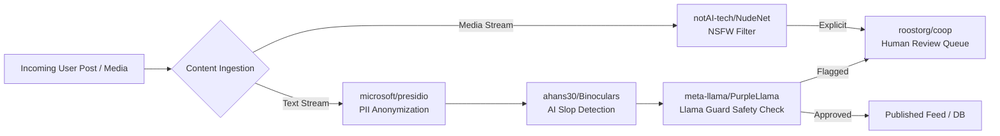

# 🛡️ Awesome Content Moderation & AI Slop Filtering

  

  
  
  
  
  
  
  

---

## 🧭 Executive Summary & Overview

A curated directory and reference index of **SaaS/Hosted Platforms** and **Open-Source GitHub Projects** specifically built for **Content Moderation**, **AI Slop Detection**, **LLM Safety Guardrails**, and **Trust & Safety Infrastructure**.

Whether you are mitigating synthetic spam feeds, preventing prompt injections and model hallucinations, detecting NSFW/CSAM media, or complying with the EU Digital Services Act (DSA) and UK Online Safety Act, this ecosystem list catalogs the leading tools, benchmarks, and production-ready runtimes.

---

## 📑 Table of Contents

- [📊 Sector Overview & Market Dynamics](#-sector-overview--market-dynamics)
- [☁️ SaaS & Enterprise Hosted Platforms](#️-saas--enterprise-hosted-platforms)
- [🔓 Open-Source GitHub Projects](#-open-source-github-projects)
- [🛠️ Architectural Blueprints & System Combinations](#️-architectural-blueprints--system-combinations)
- [🤝 How to Contribute](#-how-to-contribute)
- [⭐ Star History](#--star-history)
- [💖 Support & Community](#-support--community)
- [⚖️ Disclaimer](#️-disclaimer)

---

## 📊 Sector Overview & Market Dynamics

The global content moderation and digital safety solutions market was valued at approximately **$11.8 billion in 2024** and is projected to surpass **$32.5 billion by 2032**, expanding at a Compound Annual Growth Rate (CAGR) of **13.5%–15.2%**. This surge is heavily accelerated by generative AI spam, deepfakes, synthetic slop proliferation, and stringent regulatory mandates worldwide (such as the EU DSA, UK Online Safety Act, and US state-level youth safety acts).

The sector exhibits **moderate fragmentation with emergent concentration in specialized niches**: hyperscale cloud providers (Microsoft Azure, Amazon AWS, Google Cloud) dominate foundational multimodal safety and commodity classification infrastructure, while high-velocity specialized vendors (such as OpenAI, Hive Moderation, and ActiveFence) capture high-margin enterprise generative-AI guardrails and automated synthetic slop quarantine pipelines. Simultaneously, open-weight foundation guard models (Meta's Purple Llama / Llama Guard, NVIDIA NeMo Guardrails, and Presidio) are establishing dominant protocol layers for on-premise and privacy-sensitive runtime defenses.

---

## ☁️ SaaS & Enterprise Hosted Platforms

The table below outlines enterprise-grade, hosted content moderation and AI slop detection APIs. The listings are sorted in descending order by **Company Valuation / Estimated Market Capitalization**.

| Provider / Platform | Estimated Valuation / Market Cap | Key Moderation Capabilities | Starting Tier Pricing | Free Tier / Trial Limits |
| :--- | :--- | :--- | :--- | :--- |
| **[Microsoft Azure AI Content Safety](https://azure.microsoft.com/en-us/products/ai-services/ai-content-safety)** | **~$3.1 Trillion** (Market Cap) | Multimodal text/image severity scoring, prompt shields, jailbreak defense, hallucination detection, custom blocklists | **$0.75 per 1,000 text records**; **$1.50 per 1,000 images** (Pay-As-You-Go standard tier) | **Free forever tier**: 5,000 text transactions + 1,000 image transactions per month free |
| **[Amazon Rekognition Content Moderation](https://aws.amazon.com/rekognition/)** | **~$2.1 Trillion** (Market Cap) | Automated visual moderation, explicit nudity, suggestive apparel, violence, hate symbols detection across images and video feeds | **$0.0010 per image** (First 1M images/month tier); **$0.10 per minute** for video streaming analysis | **AWS Free Tier**: 5,000 image analyses per month free for the first 12 months (New accounts) |
| **[Google Cloud Content Safety & Perspective API](https://perspectiveapi.com/)** | **~$2.1 Trillion** (Market Cap) | Conversational toxicity, harassment, obscenity, spam filtering via Perspective API + Google Cloud Vertex AI safety filters | **$1.50 per 1,000 text requests** on Vertex AI Safety endpoints | **Free forever tier**: Perspective API provides 1 QPS (up to 86,400 requests/day) free with standard approval |
| **[OpenAI Moderation API](https://platform.openai.com/docs/guides/moderation)** | **~$157 Billion** (Valuation) | Multimodal text and image safety classification across hate speech, harassment, self-harm, sexual content, and graphic violence | **$0.00** (Free API endpoint for OpenAI developers); paid GPT-4o input/output costs apply if building custom evaluation pipelines | **Free forever endpoint**: 100% free moderation API access with tiered rate limits (Tier 1 starts at 500 RPM / 10,000 TPM) |
| **[Hive Moderation](https://thehive.ai/)** | **~$4.0 Billion** (Valuation) | Real-time multimodal AI slop detection, synthetic text/image/voice detection, deepfake identification, visual NSFW, and toxic chat filtering | **$1.50 per 1,000 API requests** (Pay-As-You-Go starter tier) | **Free trial**: 14-day free trial with 10,000 free API test credits upon developer sign-up |
| **[ActiveFence](https://www.activefence.com/)** | **~$500 Million** (Valuation) | Threat intelligence-driven platform safety, real-time GenAI safety guardrails, CSAM/terrorist content detection, multi-language abuse defense | **$1,500 / month** (Starting price for foundational developer API package) | **Free trial**: 14-day evaluation trial with up to 5,000 test requests upon sales engineering review |
| **[Sightengine](https://sightengine.com/)** | **~$80 Million** (Valuation) | Instant cloud API for AI-generated media detection, NSFW/nudity filtering, violence, scam/phishing recognition, video stream moderation | **$39 / month** (Starter plan covering 50,000 operations/month; additional at $0.0008/op) | **Free forever plan**: 2,000 free operations per month forever (Max 2 requests/second) |
| **[WebPurify](https://www.webpurify.com/)** | **~$45 Million** (Valuation) | Hybrid live human-in-the-loop + AI moderation, profanity filtering in 30+ languages, image/video automated NSFW and metaverse checks | **$10 / month** (Starter Profanity API tier for 6,000 calls/month; Automated Image API from $50/mo for 10,000 images) | **Free trial**: 14-day free trial with 1,000 free API queries across text and image services |
| **[Spectrum Labs (Guardian)](https://www.spectrumlabsai.com/)** | **~$40 Million** (Valuation) | Contextual AI behavior analysis, audio voice-chat moderation, multi-turn harassment detection for online gaming and social communities | **$2,000 / month** (Platform tier for dedicated community chat streams) | **Free trial**: 30-day proof-of-concept (PoC) sandbox trial with historic dataset benchmarking |
| **[Checkstep](https://www.checkstep.com/)** | **~$25 Million** (Valuation) | Unified Trust & Safety operations, automated multi-vendor AI orchestration, human reviewer queues, DSA & OSA compliance audit trail | **$499 / month** (Growth tier including rule engine, 25k moderated items, and reviewer seats) | **Free trial**: 14-day free trial with complete dashboard access and 2,500 free automated checks |

---

## 🔓 Open-Source GitHub Projects

The table below lists community-driven, open-source repositories for local and self-hosted content moderation, AI slop filtering, and LLM guardrails. Repositories are sorted in descending order by **GitHub Stars_Counts** ⭐.

| Repository / Project | GitHub_Stars | Core Functionality & Detection Focus | Primary Architecture / Stack |
| :--- | :---: | :--- | :--- |
| **[microsoft/presidio](https://github.com/microsoft/presidio)** |  | Context-aware PII detection, redaction, and anonymization engine protecting user-generated content and LLM training feeds | Python / C# / SpaCy / Transformers |
| **[cleanlab/cleanlab](https://github.com/cleanlab/cleanlab)** |  | Automated data curation and data-centric AI library identifying label errors, toxic slop, and outliers in multimodal datasets | Python / Confident Learning |
| **[guardrails-ai/guardrails](https://github.com/guardrails-ai/guardrails)** |  | Comprehensive schema validation, hallucination checking, profanity filtering, and structured output safety guardrails for LLMs | Python / TypeScript / Hub Validators |
| **[NVIDIA/NeMo-Guardrails](https://github.com/NVIDIA/NeMo-Guardrails)** |  | Programmable dialog guardrail toolkit enforcing topical control, safety guidelines, and hallucination reduction using Colang | Python / LangChain / Colang |
| **[meta-llama/PurpleLlama](https://github.com/meta-llama/PurpleLlama)** |  | Meta's flagship safety suite containing Llama Guard (1/2/3), Prompt Guard, and Code Shield against MLCommons hazard taxonomies | PyTorch / Hugging Face / Transformers |
| **[deepchecks/deepchecks](https://github.com/deepchecks/deepchecks)** |  | Holistic testing, validation, and safety monitoring framework for LLM interactions and multimodal ML data pipelines | Python / Scikit-learn / PyTorch |
| **[truera/trulens](https://github.com/truera/trulens)** |  | Evaluation and guardrail suite measuring groundedness, QA relevance, toxicity, and hallucination metrics on LLM applications | Python / OpenTelemetry / Feedback Functions |
| **[protectai/llm-guard](https://github.com/protectai/llm-guard)** |  | Production-grade security toolkit scanning LLM prompt inputs and model outputs for slop, toxicity, PII, prompt injections, and bans | Python / ONNX / Hugging Face |
| **[notAI-tech/NudeNet](https://github.com/notAI-tech/NudeNet)** |  | Self-hosted neural network for fine-grained nudity classification and object-level automated censoring/blurring | Python / PyTorch / OpenCV |
| **[unitaryai/detoxify](https://github.com/unitaryai/detoxify)** |  | Fast, multilingual pre-trained transformer models for predicting toxicity, severe toxicity, obscenity, threats, and hate speech | Python / PyTorch / Hugging Face |
| **[whylabs/langkit](https://github.com/whylabs/langkit)** |  | Lightweight open-source library for monitoring LLM inputs/outputs for toxicity, text quality, sentiment, and slop patterns | Python / whylogs |
| **[bhky/opennsfw2](https://github.com/bhky/opennsfw2)** |  | Clean TensorFlow 2 / Keras implementation of Yahoo's OpenNSFW model for low-latency image and video frame scoring | Python / TensorFlow 2 / Keras |
| **[roostorg/osprey](https://github.com/roostorg/osprey)** |  | High-throughput distributed anti-spam, abuse detection, and event-stream rule engine originally engineered at Discord | Go / Apache Kafka / Lua |
| **[ahans30/Binoculars](https://github.com/ahans30/Binoculars)** |  | Zero-shot LLM text detector comparing cross-perplexity ratios between dual language models to identify AI slop without fine-tuning | Python / Hugging Face Transformers |
| **[roostorg/coop](https://github.com/roostorg/coop)** |  | Open-source Trust & Safety case management and review platform providing moderation queues, rules engines, and NCMEC pipelines | Python / React / PostgreSQL |
| **[allenai/wildguard](https://github.com/allenai/wildguard)** |  | Multi-task open-weight moderation model identifying prompt harmfulness, response safety, and refusal compliance in conversations | PyTorch / vLLM / Hugging Face |

---

## 🛠️ Architectural Blueprints & System Combinations

For teams architecting a robust, defense-in-depth content safety stack:

- **Slop & Synthetic Text Filtering**: Pair **Binoculars** (zero-shot cross-perplexity detector) with **Protect AI LLM Guard** to filter AI-generated SEO junk and synthetic comments before database persistence.
- **Multimodal Visual Safety**: Combine **NudeNet** for fine-grained bounding-box masking with **Azure AI Content Safety** or **Sightengine** for multi-angle visual threat mitigation.
- **End-to-End Enterprise Operations**: Ingest events via **Osprey** (Discord's event-stream engine) and route ambiguous or sensitive flags to **Coop** for human reviewer queues and audit logging.

---

## 🤝 How to Contribute

Contributions are warmly welcomed! Help keep this ecosystem comprehensive, transparent, and up-to-date:

1. **Fork the Repository**: Click `Fork` on GitHub.
2. **Add / Update Entries**:
   - For SaaS products: include Provider, Valuation/Market Cap, Specific Features, Starting Tier Price, and Specific Free Tier/Trial limits.
   - For Open-Source projects: include the GitHub Stars_Badge (`style=social&color=white`) linking to the repository's stargazers page.
3. **Validate & Format**: Keep markdown tables clean and descriptions concise and factual.
4. **Submit a Pull Request**: Reference relevant documentation or official pricing pages in your PR description.

---

## 📈 Star History

---

## 💖 Support & Community

Thank you for visiting and supporting the **Awesome Content Moderation & AI Slop Filtering** project! Building open, transparent digital spaces and keeping platforms resilient against synthetic slop requires community collaboration.

If you find this repository valuable:
- ⭐ **Star this repository** to improve discoverability for other developers and Trust & Safety practitioners.
- 🍴 **Fork & Share** it across your network on LinkedIn, X/Twitter, and Discord.
- ☕ **Buy me a coffee / Sponsor**: If this curation saves your team engineering hours, consider sponsoring ongoing maintenance via the **[GitHub Sponsor Dashboard](https://github.com/sponsors/ishandutta2007)**!

---

## ⚖️ Disclaimer

- This catalog is a community-curated research directory and does not constitute commercial endorsement or legal advice.
- Machine learning classifiers and AI slop detection algorithms may yield false positives (particularly on non-native writing samples or stylized artwork) and false negatives. Critical safety workflows should pair automated defenses with transparent user appeals and human-in-the-loop oversight.
- Organizations deploying automated Trust & Safety mechanisms in regulated regions should ensure compliance with the **EU Digital Services Act (DSA)**, **UK Online Safety Act (OSA)**, and applicable regional privacy standards.
